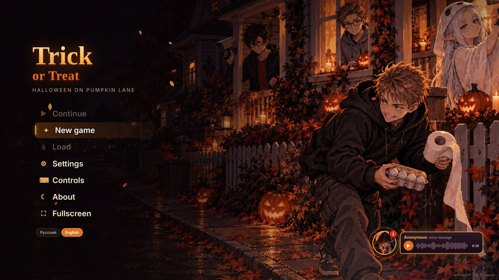
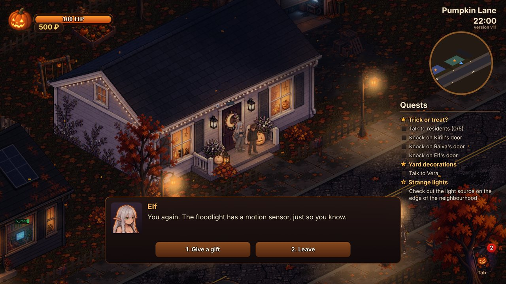
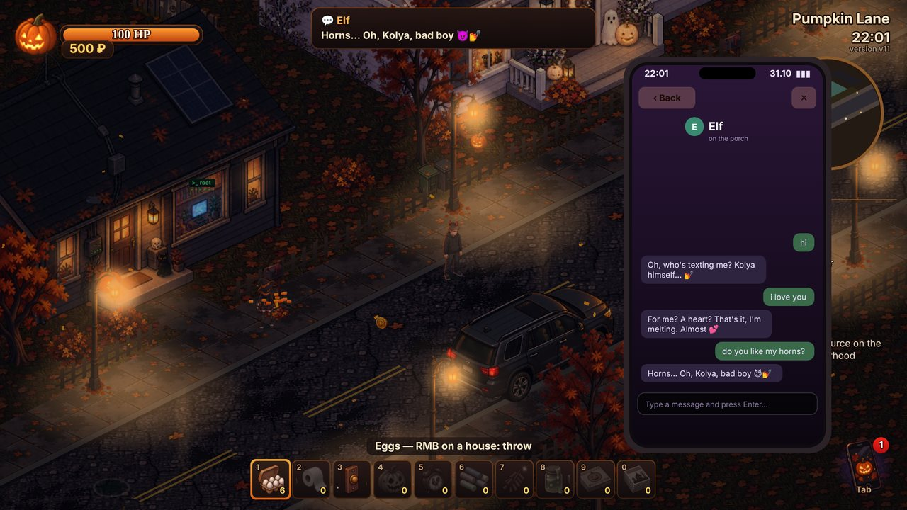
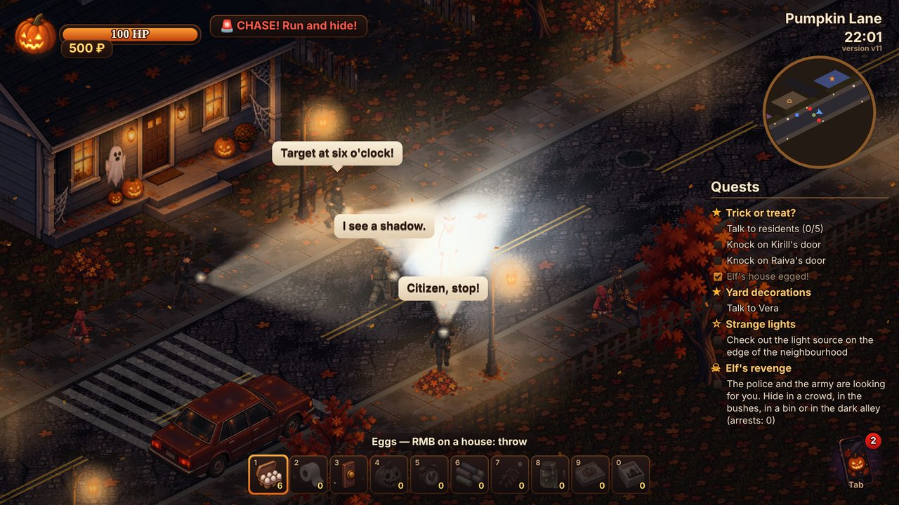

# Trick or Treat 🎃

[🇷🇺 Русский](README.md) · **🇬🇧 English**

A pixel-art isometric Halloween game (Russian and English — switch in the main menu). Kolya walks to the houses of his moderators — Kirill, Raiva and Elf — and asks for a «treat». Refused? Then it's a trick: eggs, toilet paper, a rotten pumpkin, firecrackers, slime on the door handle, ten pizzas… Every moderator takes revenge in their own way, and at the end of the night a surprise waits for Kolya at home.

**Play in the browser:** https://allanscream.github.io/Hallowieen-game-nigth-/
(needs a WebGL2 browser: Chrome, Edge, Firefox; the first load is about 22 MB). Pick **English** in the main menu.



| | |
|---|---|
|  |  |
| Knock and ask for a treat | Contacts answer what you write |
|  |  |
| Elf's revenge: a police and army raid | Rain, thunderstorms and the ghost costume |
|  |  |
| Costumes from Vera's chest | The backyards behind the houses |

## Run it on your computer (Windows)

1. Download the repository: the green **Code → Download ZIP** button, then unpack it.
2. Double-click **«Запустить_игру.bat»** (Run the game) — a server window and the browser with the game open.
   Python 3 is required (python.org). Keep the server window open while you play.

Manually: run `python serve.py` in the repository folder — the address appears in the window.
Opening `game/index.html` with a double click won't work: browsers don't let WebGL read pictures from the disk.

## Controls

| Key | Action |
|---|---|
| LMB | walk, talk, knock |
| WASD | walk, Shift — run |
| RMB | throw exactly at the cursor (toilet paper — hold and release) |
| 1–0, wheel | choose a trick |
| E | action on the spot (at a post with a flyer — take it down) |
| G | put the rotten pumpkin down |
| F | airsoft rifle (RMB — shoot) |
| Tab | phone: map, chats, flashlight, shop, pizza, contacts, console |
| Space | hide (bushes, bins, the dumpster) |
| M | sound |
| Esc | pause, saves, settings |

## What's inside

- Russian and English (buttons in the main menu and in the settings).
- Main menu music — «お菓子の森» by whiteelv, in the game — a music box; both can be changed in the settings. A voice message waits in the menu.
- A street of 7 houses, a dark alley, open backyards (greenhouses, sheds, trampolines, swings, wickets between the plots) and a wood, 8 passers-by in costumes, a black cat, Vera's candy bowl.
- Rain and thunderstorms: puddles and splashes underfoot, thunder, lightning knocks the street lights out (in the dark the patrol sees less).
- Costumes from Vera's chest after her quest: ghost, pumpkin head, wizard's hat, little devil horns.
- 10 tricks and a «egged» meter for every moderator, favourite gifts for the peaceful path.
- Tricks anywhere: firecrackers stun passers-by and the patrol, chalk, an alarm-clock decoy, the doorbell and slime on any door.
- Passers-by hold grudges: after three hits they chase you and take revenge (eggs back, «damages», a toilet-paper mummy).
- Three revenges: an underpants auction (Kirill), a virus on your phone (Raiva), a police and army raid (Elf).
- The phone: the moderators' group chat, contacts who answer what you write (each in their own way, sometimes with swearing), debts and a developer console (`help`).
- Kolya is drawn in 32 walking directions (hands free, with the flashlight, with the rifle), throws and carrying the pumpkin — in 16.
- Main menu, 6 save slots, volume and night darkness settings.
- Two visual-novel endings: the surprise party and the kind one (everyone forgiven, not a single trick).
- 15 achievements: a Steam-like popup and an «Achievements» app on the phone.

## Layout

```
game/        the playable build: index.html, engine and game scripts, assets/ (pictures), media/ (menu music, the voice message)
  sim.js     the simulation (120 Hz, deterministic): rules, moderators, the raid, the phone
  scene.js   rendering: isometry, light, weather, interface, character atlases
  audio.js   sound synthesized with WebAudio on the fly (the menu music is a file)
  i18n.js    on-the-fly translation (canvas, labels, menu); lang_en.js — the RU→EN dictionary
serve.py     local server (takes the first free port from 8011, no cache)
docs/        screenshots for this page
dev/         development sources
  tools/     art pipeline and checks: mannequin poses, atlas slicing, packing, automated tests
  art/       generation prompts, mannequin poses, generator jobs; art/i18n — English texts and the contacts' answers
  index_live.html  the development page with live reload
```

The art was generated (OpenAI gpt-image) from the prompts in `dev/art/prompts`; the pose of every frame comes from the 3D mannequin `dev/tools/mannequin.py`, and `dev/tools/kframes.py` slices the atlases. The original references and raw generation sheets are not in the repository.
