# Сладость или гадость 🎃

**🇷🇺 Русский** · [🇬🇧 English](README.en.md)

Пиксельная изометрическая игра про ночь Хэллоуина (русский и английский — переключатель в главном меню). Коля обходит дома своих модераторов — Кирилла, Райвы и Эльфа — и просит «сладость». Отказали? Тогда гадость: яйца, туалетная бумага, гнилая тыква, петарды, слизь на дверной ручке, десять пицц… Каждый модер мстит по-своему, а в конце ночи дома у Коли ждёт сюрприз.

Начинается всё в комнате Коли: стрим реакций, донат «закидай модеров, слабо?», напоминание о Хэллоуине и голосовое Эльфа в чате модеров. А за южным забором шумит праздник: резьба по тыкве, яблоки из бочки, конкурс костюмов и гача-автомат.

**Играть в браузере:** https://allanscream.github.io/Hallowieen-game-nigth-/
(нужен браузер с WebGL2: Chrome, Edge, Firefox; первая загрузка ~26 МБ)

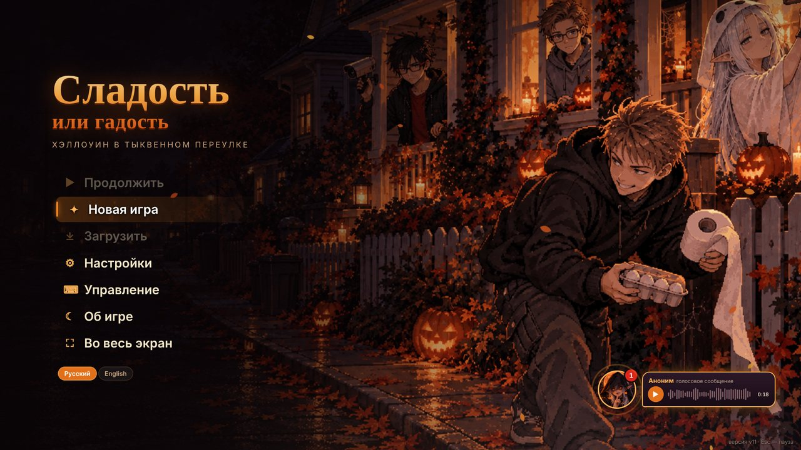

| | |
|---|---|
| 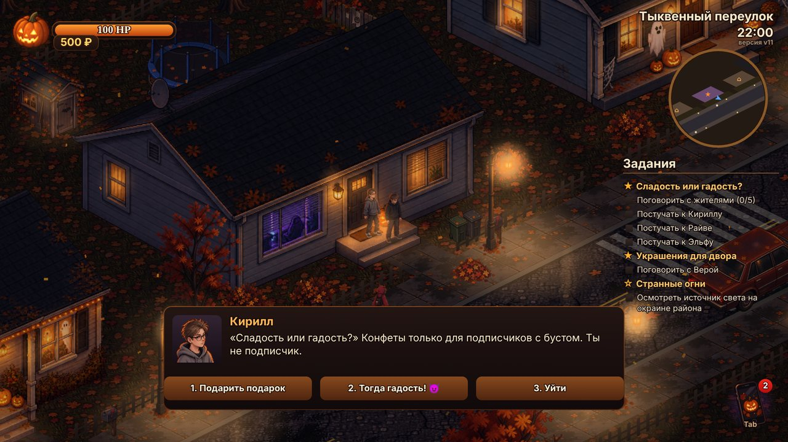 | 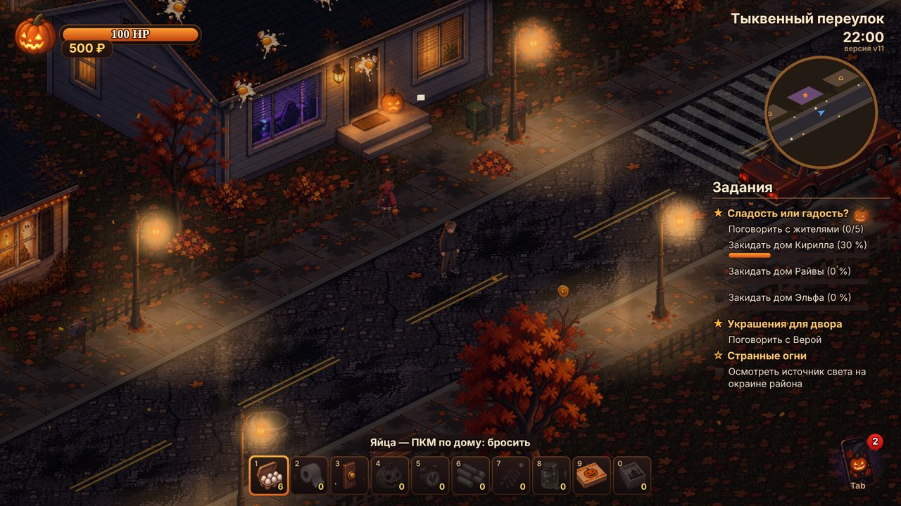 |
| Постучи и попроси сладость | Отказали — закидай дом |
| 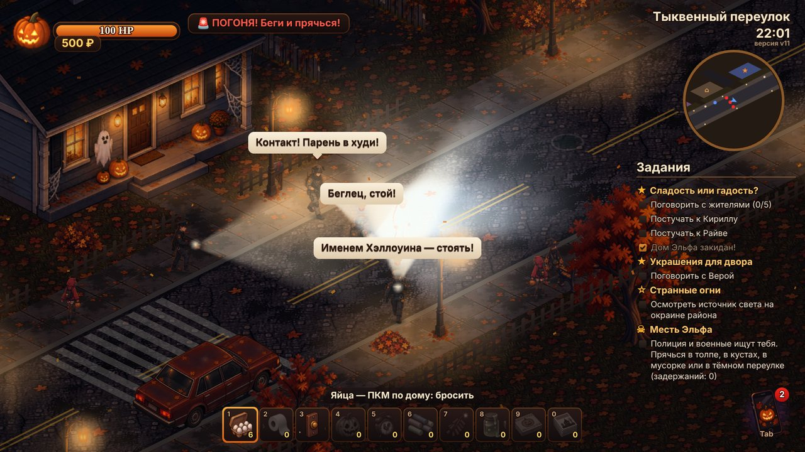 | 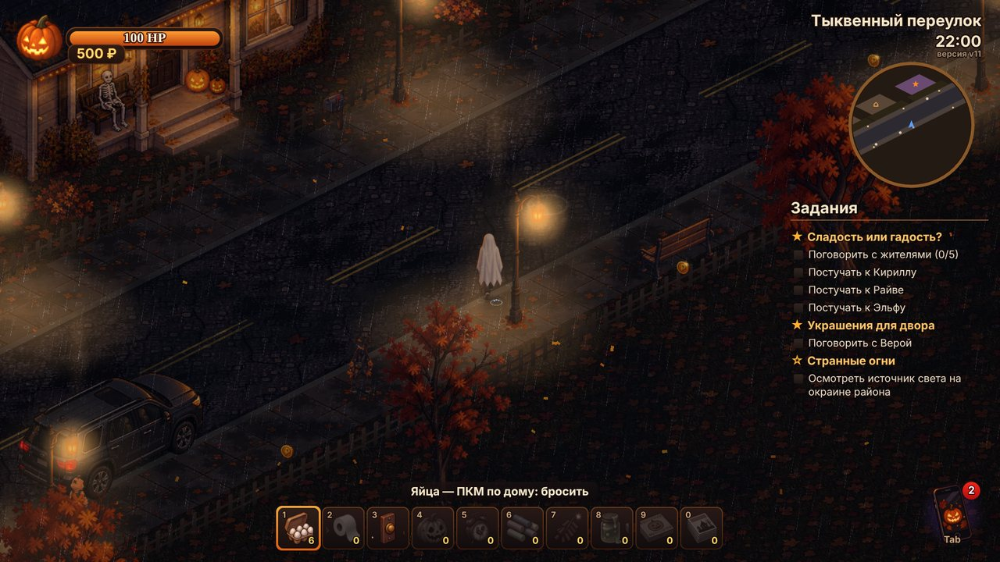 |
| Месть Эльфа: облава полиции и военных | Дождь, гроза и костюм призрака |
| 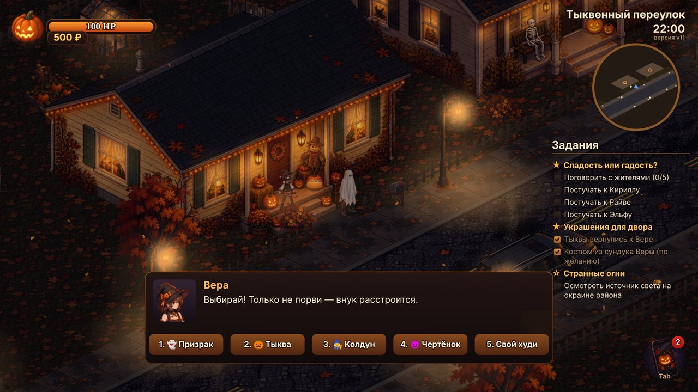 | 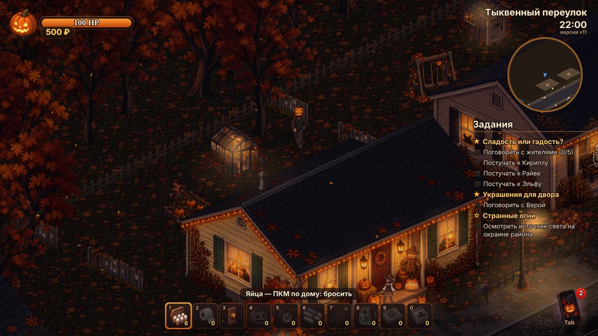 |
| Костюмы из сундука Веры | Задние дворы за домами |
| 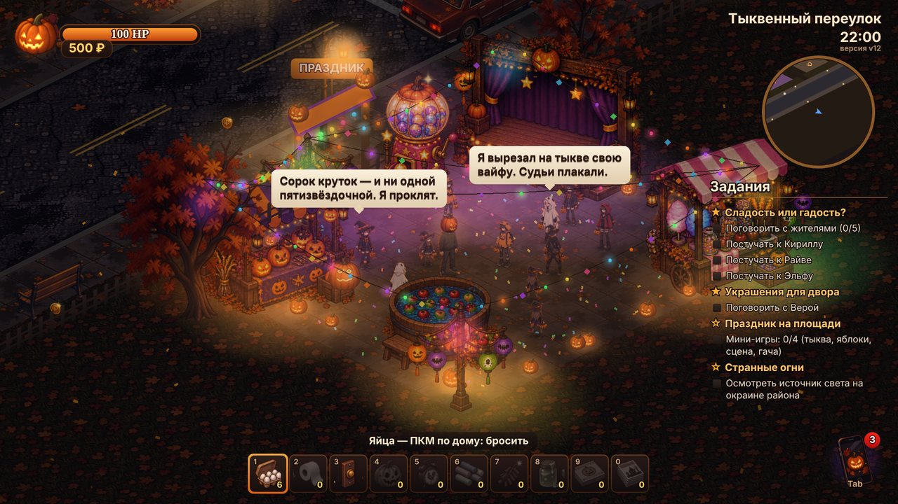 | 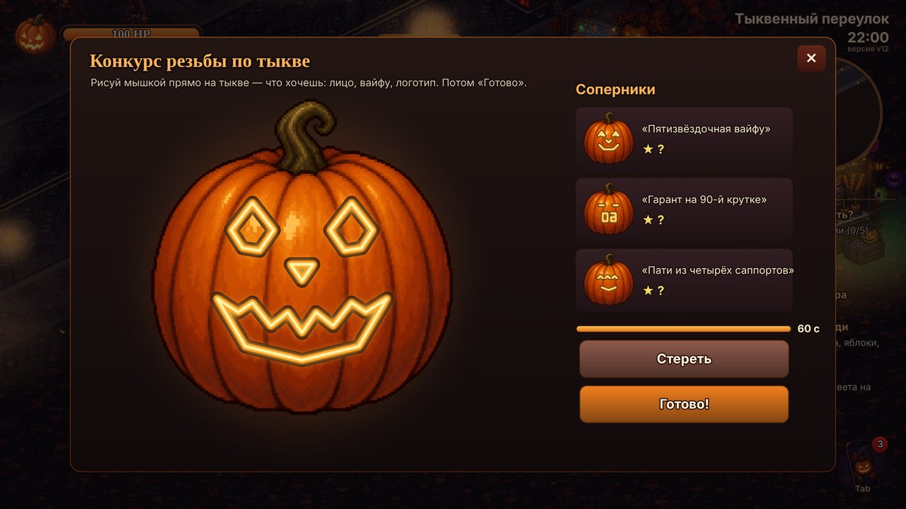 |
| Праздник на площади за южным забором | Резьба по тыкве: рисуй что хочешь |
| 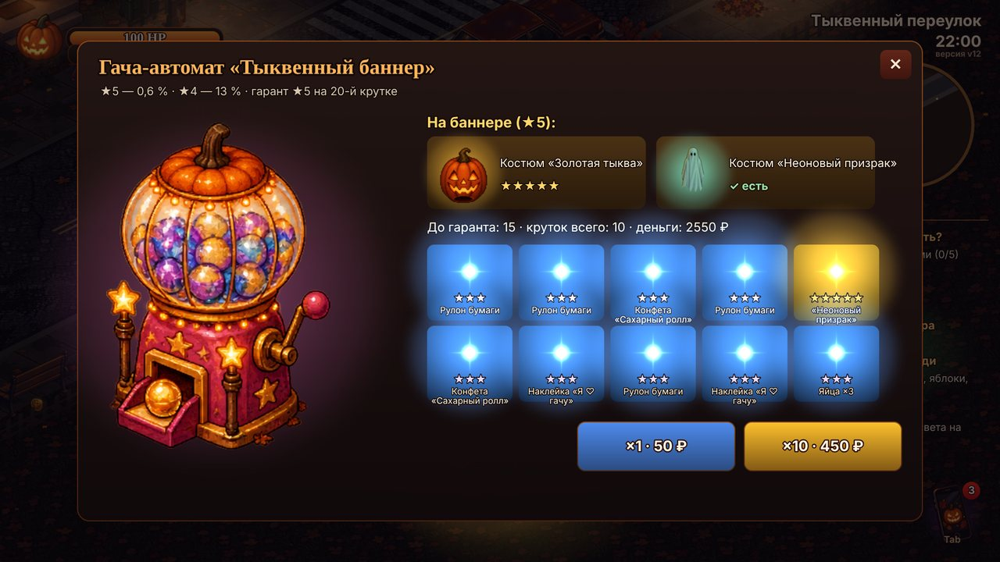 | 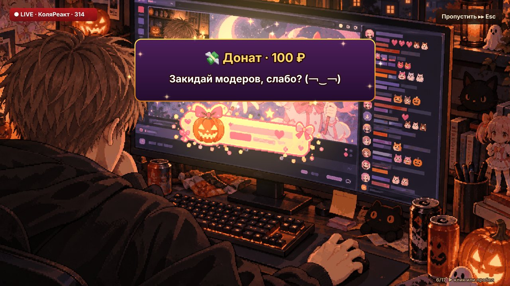 |
| Гача-автомат «Тыквенный баннер» | Пролог: стрим, донат и голосовое |

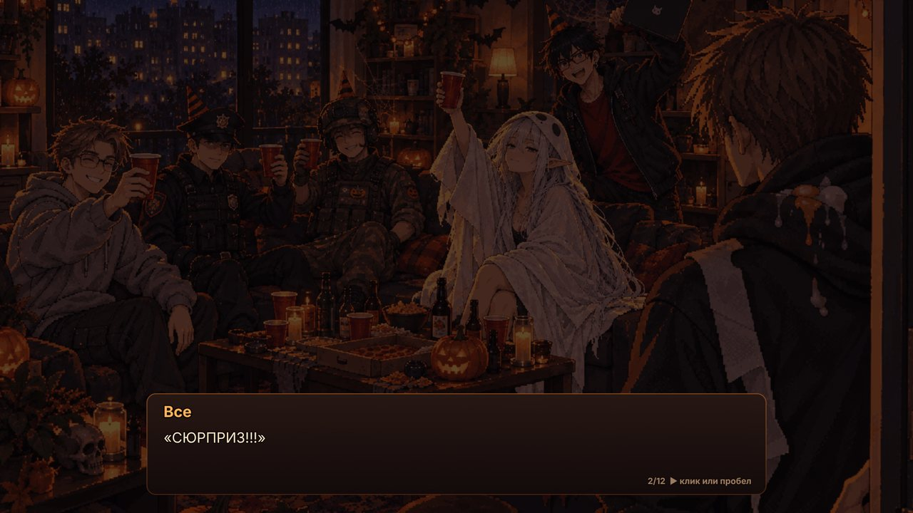

## Запуск на компьютере (Windows)

1. Скачай репозиторий: зелёная кнопка **Code → Download ZIP**, распакуй.
2. Дважды щёлкни **«Запустить_игру.bat»** — откроется окно сервера и браузер с игрой.
   Нужен Python 3 (python.org). Окно сервера не закрывай, пока играешь.

Вручную: в папке репозитория `python serve.py` — адрес появится в окне.
Просто открыть `game/index.html` двойным кликом не получится: браузер не даёт WebGL читать картинки с диска.

## Управление

| Клавиша | Действие |
|---|---|
| ЛКМ | идти, говорить, стучать |
| WASD | ходьба, Shift — бег |
| ПКМ | бросок точно в курсор (бумагу — зажать и отпустить) |
| 1–0, колесо | выбор гадости |
| E | действие на месте (у столба с флаером — снять его, у лавки на празднике — открыть) |
| Q | скрыть / показать задания |
| G | положить гнилую тыкву |
| F | страйкбольный автомат (ПКМ — стрелять) |
| Tab | телефон: карта, чаты, фонарик, магазин, пицца, контакты, консоль |
| Space | спрятаться (кусты, баки, контейнер) |
| M | звук |
| Esc | пауза, сохранения, настройки |

## Что внутри

- Пролог сценами в комнате Коли (стрим «КоляРеакт», донат, голосовое Эльфа) — в первой новой игре, ещё раз — «Об игре» → «Смотреть пролог». После обеих концовок — эпилог у стрима, чат обсуждает ночь.
- Праздник на площади: резьба по тыкве (свободное рисование мышкой, три судьи, соперники), яблоки из бочки, конкурс костюмов (позы стрелками), гача-автомат (★3/★4/★5, гарант на 20-й крутке, легендарные костюмы «Золотая тыква» и «Неоновый призрак»), сладкая лавка.
- Язык: русский и английский (кнопки в главном меню и в настройках).
- Музыка главного меню — «お菓子の森» (whiteelv), в игре — музыкальная шкатулка; обе можно поменять в настройках. В меню ждёт голосовое сообщение.
- Улица из 7 домов, тёмный переулок, открытые задние дворы (теплицы, сараи, батуты, качели, калитки между участками) и лес, 8 прохожих в костюмах, чёрный кот, миска конфет у Веры.
- Дождь и гроза: лужи и брызги под ногами, гром, молния гасит фонари на улице (в темноте патрулю хуже видно).
- Костюмы из сундука Веры после её задания: призрак, тыква на голове, шляпа колдуна, рожки чертёнка; все открытые костюмы можно надеть и дома — в шкафу у Коли.
- 10 гадостей и шкала «закиданности» для каждого модера, любимые подарки для мирного пути.
- Гадости где угодно: петарды оглушают прохожих и патруль, мелки (рисуй что хочешь, пять цветов), будильник-приманка, звонок и слайм на любой двери.
- Прохожие помнят обиды: после трёх попаданий догоняют и мстят (яйца в ответ, «моральный ущерб», мумия из бумаги).
- Три мести: аукцион трусов (Кирилл), вирус в телефоне (Райва), облава полиции и военных (Эльф).
- Телефон: список бесед (у каждого контакта своя переписка), групповой чат модеров с голосовым Эльфа, контакты отвечают на то, что ты пишешь — гача, аниме, стрим, праздник, погода, «помоги» с подсказкой и ещё два десятка тем (по-своему, с каомодзи и иногда с матом), долги и консоль разработчика (`help`, колесо — листать).
- Коля нарисован в 32 направлениях ходьбы (руки свободны, с фонариком, с автоматом), броски и ношение тыквы — в 16.
- Главное меню, 6 слотов сохранений, настройки громкости и темноты ночи.
- Две концовки в стиле визуальной новеллы: вечеринка-сюрприз и добрая (все прощены, ни одной гадости).
- 20 достижений: карточка как в Steam и приложение «Достижения» в телефоне.

## Структура

```
game/        играбельная сборка: index.html, скрипты движка и игры, assets/ (картинки), media/ (музыка меню, голосовое)
  sim.js     симуляция (120 Гц, детерминированная): правила, модеры, облава, телефон
  scene.js   отрисовка: изометрия, свет, погода, интерфейс, атласы персонажей
  audio.js   звук синтезируется WebAudio на лету (музыка меню — файл)
  i18n.js    перевод на лету (canvas, подписи, меню); lang_en.js — словарь RU→EN
serve.py     локальный сервер (берёт свободный порт с 8012, без кэша)
docs/        скриншоты для этой страницы
dev/         исходники для разработки
  tools/     конвейер арта и проверки: манекен-позы, нарезка атласов, сборка, автотесты
  art/       промпты генерации, позы-манекены, задания для генератора; art/i18n — английские тексты и ответы контактов
  index_live.html  страница разработки с живой перезагрузкой
```

Арт сгенерирован (OpenAI gpt-image) по промптам из `dev/art/prompts`; позы для каждого кадра задаёт 3D-манекен `dev/tools/mannequin.py`, атласы режет `dev/tools/kframes.py`. Исходные референсы и сырые листы генерации в репозиторий не входят.
